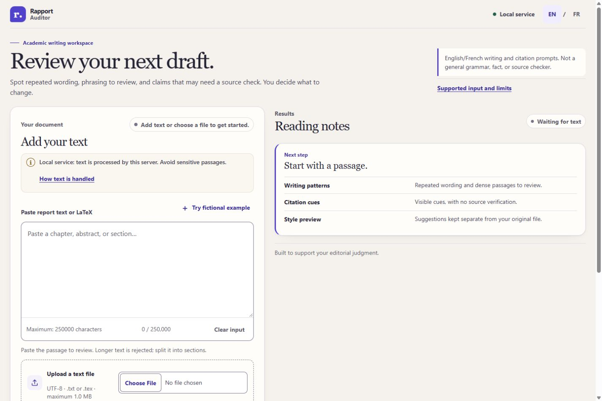

# Rapport Auditor

Rapport Auditor is a bilingual review workspace for academic report drafts. It helps writers notice repeated wording, long or dense sentences, a short list of formulaic phrases, and explicit empirical-reporting sentences that may deserve a source check. It can also preview a small set of conservative text edits without changing the original file.

The analysis is deterministic and uses separate, narrow English and French cue rules. Findings are human review prompts, not judgments about writing quality. Citation markers are only visible cues: the app does not resolve bibliography entries or check a source’s existence, relevance, or accuracy. It does not detect plagiarism or authorship, or verify factual claims. The synthetic fixtures establish rule conformance for those examples only, not real-world reliability; see [the evaluation notes](docs/EVALUATION.md).



Current interface captures use synthetic text: [English desktop home](docs/screenshots/ux-home-desktop.jpg), [French mobile home](docs/screenshots/ux-home-mobile-fr.jpg), [English desktop review](docs/screenshots/ux-review-desktop.jpg), [French mobile review](docs/screenshots/ux-review-mobile-fr.jpg), and [desktop revision preview](docs/screenshots/ux-revision-desktop.jpg). They show the interface only; they are not evidence of analysis accuracy.

The earlier automated browser checks also capture [a clean synthetic review](docs/screenshots/sample-review.png) and a [synthetic review with repetition and source-check prompts](docs/screenshots/sample-findings.png). Both examples are fictional and contain no real study, source, or result. The [verification guide](docs/TESTING.md) distinguishes those automated captures from the current in-app Chromium review.

## Privacy and input

In local mode, run the app on the machine that holds the draft. In public server mode, pasted text and uploads are sent to the hosting server over HTTPS for processing. The application does not call a third-party writing service and is designed not to persist draft content, but this does not control the host's memory, crash dumps, backups, or infrastructure telemetry. A hosted service needs a privacy notice specific to its provider and retention settings. The app accepts UTF-8 `.txt` and `.tex`; request and text limits are enforced, and oversized input is rejected rather than truncated. See [security and privacy notes](docs/SECURITY.md) and the [public deployment runbook](docs/PRODUCTION.md).

The default CLI binds to `127.0.0.1`. Keep it loopback-only unless you have reviewed the network exposure and host configuration. The request parser uses bounded in-memory streams; the Waitress CLI also configures its input/output buffers so accepted documents and rendered results stay below its temporary-file spill thresholds. See [Security and privacy notes](docs/SECURITY.md) for the boundaries and operating-system limitations.

## Install

Python 3.10 or newer is required. On Windows PowerShell:

```powershell
py -3.10 -m venv .venv
.venv\Scripts\python.exe -m pip install -r requirements-runtime.lock
.venv\Scripts\python.exe -m pip install setuptools==84.0.0
.venv\Scripts\python.exe -m pip install -e . --no-deps --no-build-isolation
```

On macOS or Linux:

```sh
python3 -m venv .venv
.venv/bin/python -m pip install -r requirements-runtime.lock
.venv/bin/python -m pip install setuptools==84.0.0
.venv/bin/python -m pip install -e . --no-deps --no-build-isolation
```

## Run

Windows PowerShell:

```powershell
.venv\Scripts\python.exe -m rapport_api.cli
```

macOS or Linux:

```sh
.venv/bin/python -m rapport_api.cli
```

Open [http://127.0.0.1:5000](http://127.0.0.1:5000). The server uses Waitress rather than Flask’s debug server. It stops when you press `Ctrl+C` in the terminal.

## What it does

- Accepts pasted text and UTF-8 `.txt` / `.tex` files.
- Shows word and sentence counts, repeated patterns, long/dense sentences, and a small list of formulaic English and French phrases.
- Prompts a human to inspect selected empirical-reporting wording and visible citation cues; it never resolves references or verifies source support.
- Previews suggested edits and a diff; nothing is written to the source file.
- Offers an opt-in synthetic example that never replaces existing text without confirmation.
- Keeps interface locale separate from the explicitly selected report language (`en` or `fr`).

## Tests

```powershell
.venv\Scripts\python.exe -m pip install -r requirements-dev.lock
.venv\Scripts\python.exe -m pip install setuptools==84.0.0
.venv\Scripts\python.exe -m pip install -e . --no-deps --no-build-isolation
.venv\Scripts\python.exe -m pytest
.venv\Scripts\python.exe -m ruff check .
.venv\Scripts\python.exe -m pip check
.venv\Scripts\python.exe -m pip_audit -r requirements-runtime.lock
.venv\Scripts\python.exe -m pip_audit -r requirements-dev.lock
```

The lock files pin the dependency resolution made with Python 3.10. Platform-marked packages may differ by operating system; use the same Python version and target platform when reproducing an environment.

For local browser and axe checks, start the app first, then install and run the optional Node test tools:

```powershell
npm ci --prefix scripts
$env:RAPPORT_AUDITOR_CHROME = "C:\Program Files\Google\Chrome\Application\chrome.exe"
npm run --prefix scripts test:browser
```

See [the verification guide](docs/TESTING.md) for browser coverage and limits, synthetic fixtures, screenshot paths, and manual accessibility checks.

## Project layout and API

```text
apps/api/rapport_api/        Flask app factory, JSON API, and Waitress CLI
apps/web/rapport_web/        Jinja pages, CSS, and progressive-enhancement JavaScript
packages/core/rapport_auditor/  deterministic analysis and revision functions
tests/                       core, route, security, boundary, and CLI tests
```

The JSON API is same-origin and requires a CSRF bootstrap: `GET /api/v1/csrf` returns a token and sets its matching cookie; send both the cookie and `X-CSRF-Token` header on `POST /api/v1/audit` or `/api/v1/revise`. `GET /api/v1/health` is a small health check. Request examples, response fields, error statuses, and size limits are in the [API guide](docs/API.md). The Python app factory is `rapport_api.create_app()`; the command-line entry point starts the local Waitress server.

The standalone Caddy profile is in [`deployment/compose.yaml`](deployment/compose.yaml). A separate Traefik profile targets `rapport.chames.tn` in [`deployment/compose.traefik.yaml`](deployment/compose.traefik.yaml), but neither profile proves a live deployment. See the [production runbook](docs/PRODUCTION.md), [same-VPS co-hosting runbook](docs/COHOSTING.md), and [private Git/deployment guide](docs/GIT_DEPLOYMENT.md) for the required live checks and manual update steps. Confirm the hosting operator, proxy/CDN behavior, and infrastructure retention before inviting public documents.
